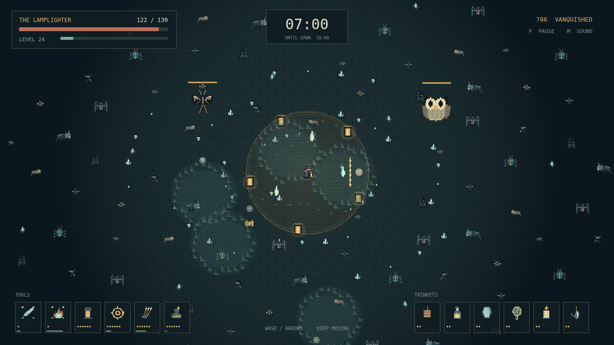

# Wick

One lamp burns in a city that has forgotten the sun. You are its lamplighter, and everything in the dark is coming closer. Keep walking. Your tools know what to do.

A slash of candlelight, a circling lantern, a shower of pins: every tool fires on its own rhythm. Find room to move, gather the gems your enemies leave behind, and choose a new gift whenever your lamp burns brighter. Six tools and six trinkets leave plenty of ways to make the night your own.

The first moth is only the beginning. Bats, spiders, and heavier shadows thicken the streets. Great winged creatures carry chests; with a tool at its highest level and its companion trinket in hand, a chest can transform your light into something fiercer.

Then the Dark arrives. You do not have to conquer the night. You have to keep the light until 10:00, when dawn finally comes.

